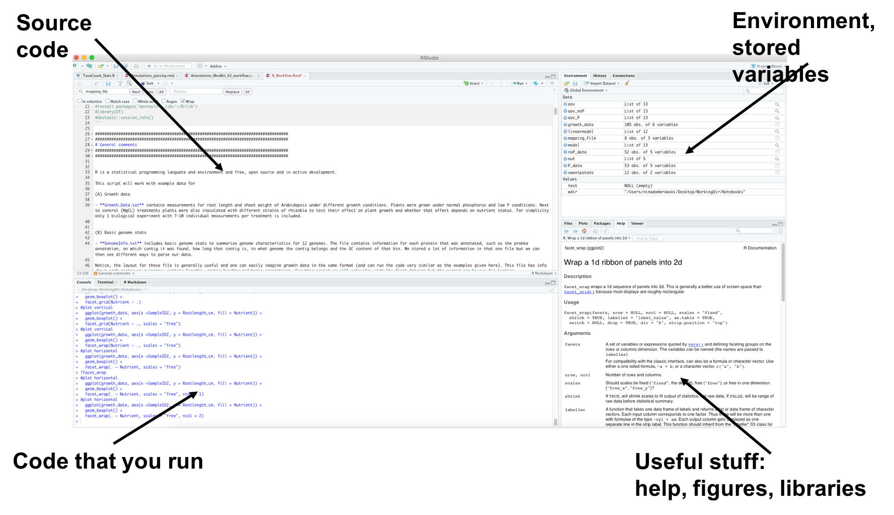
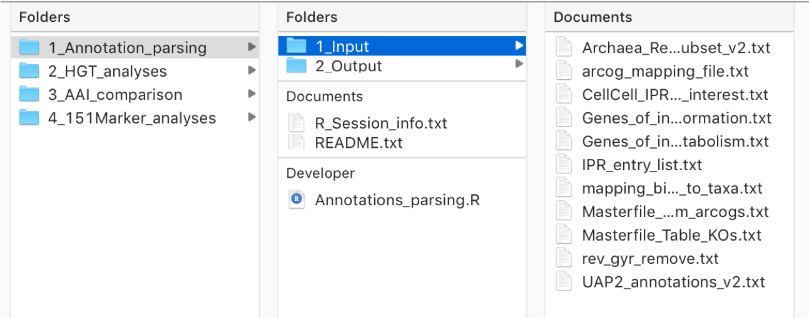
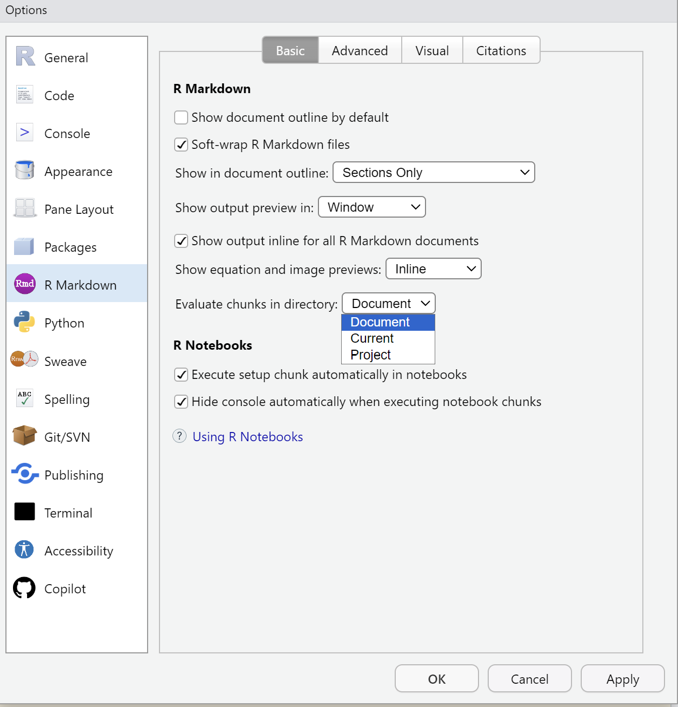
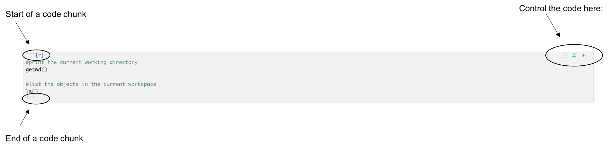
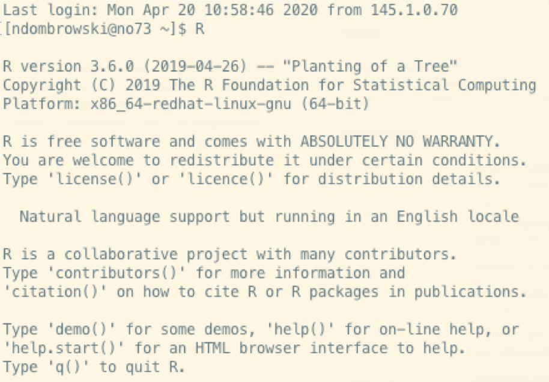

---
execute:
    eval: true

df-print: paged
---

# Getting started

R is a free, open source programming language for statistics and data analysis. It is widely used in biology, for example to analyse experiments, run statistical tests and make plots.

This chapter gets you set up. You will install R and RStudio, learn your way around RStudio, make a project folder for this tutorial and write your first Quarto document. In the chapter [Documenting your code](documenting_code.qmd) you learn how to write good notes in your Quarto document, and in [First steps in R](first_steps.qmd) you start working with real data.

## Installation

To follow this tutorial you need two programs: **R** and **RStudio**. R is the program that actually runs your code. RStudio is an editor that makes working with R easier: you write your code in it, run it, and see your tables and plots in one window. RStudio needs R to work, so install R first.

Both programs are free and work on Windows, Mac and Linux.

### Step 1: Install R

1.  Go to the R download page: <https://cran.r-project.org/>
2.  Click the download link for your operating system.
    -   **Windows:** click "Download R for Windows", then "base", then the download link at the top of the page.
    -   **Mac:** click "Download R for macOS". There are two installers. Pick the one that matches the chip in your Mac: "arm64" for newer Macs with an Apple chip (M1, M2, ...) and "x86_64" for older Macs with an Intel chip. If you are not sure, click the Apple menu and choose "About This Mac".
3.  Open the file you downloaded and follow the steps of the installer. The default settings are fine.

### Step 2: Install RStudio

1.  Go to the RStudio download page: <https://posit.co/download/rstudio-desktop/>
2.  R is already installed, so you can skip step 1 on that page. Download the RStudio installer for your operating system.
3.  Open the file you downloaded and follow the steps of the installer.

### Step 3: Check that it works

Open RStudio. You do not need to open R itself, RStudio starts it for you. In the window called **Console** (by default on the left side) you should see a message that starts with the R version, for example `R version 4.4.2`.

Click into the Console, type the following and press Enter:

```{r}
1 + 1
```

If R answers with `[1] 2`, everything is installed correctly. The `[1]` just means that this is the first value of the answer.

::: callout-note
rIf you already have R and RStudio installed, check how old they are. Packages are often only built for recent R versions, so a very old R can cause errors when you install packages. To see your R version, type `R.version.string` in the Console.
:::

## Find your way around RStudio

R on its own only has a command line: you type a command, press Enter and get an answer. RStudio puts a graphical interface around R, with windows and buttons, so that you can see your code, your data and your plots side by side.

### The four panes

RStudio is split into four areas, called **panes**:

<p align="left">



</p>

-   **Source (top left):** this is where you write and edit your files, for example the Quarto document you create below. This pane only appears once you open or create a file.
-   **Console (bottom left):** this is where R actually runs your code and prints the results. You can also type commands here directly.
-   **Environment (top right):** lists everything you have stored in R during this session, for example tables you have read in. Click on a table to look at it.
-   **Files, Plots, Packages, Help (bottom right):** shows the files in your folder, your plots, the packages you have installed and the help pages.

You can rearrange the panes under Tools \> Global Options \> Pane Layout, so the positions on your computer might be different.

## Make a project folder

Before you write any code, make a folder for this tutorial. R needs to know where your files are, and a clear folder structure makes this easy.

### The working directory

R always works from one folder on your computer, the **working directory**. When you tell R to read a file, for example `data/Growth_Data.txt`, it looks for it starting from the working directory. To see which folder R is currently using, type:

```{r}
#| eval: false

getwd()
```

It is a good idea to make one folder per project, with the same structure each time: for example a subfolder for the input data, one for the output files, and your scripts. Here is an example for a project folder that contains four sub-projects:

<p align="left">



</p>

In the example above you can see that I have different sub-folders for different analyses I did for a project of mine. One sub-folder is open and you see that it contains an R script and folders for the input and output files. If you plan to share your analysis with others, it is also good to add a README file that explains what the analysis is about.

### Make an RStudio project

The easiest way to get the working directory right is an **RStudio Project**. A project is a folder on your computer that RStudio remembers. When you open the project, RStudio automatically sets the working directory to that folder. This means you never have to type the full path to your files, and your code keeps working if you move the folder or share it with someone else.

To create a project for this tutorial:

1.  Go to File \> New Project \> New Directory \> New Project.
2.  Give the folder a name, for example `R_tutorial`, and choose where it should be saved with "Browse".
3.  Click "Create Project".

RStudio now opens the project. You will see a file ending in `.Rproj` in the Files pane. The next time you want to work on this tutorial, open RStudio and use File \> Open Project, or double-click the `.Rproj` file.

You can check that it worked with `getwd()`. It should print the path of your new project folder.

From now on, all paths in this tutorial are written relative to the project folder. For example, `data/Growth_Data.txt` means "the file `Growth_Data.txt` in the folder `data` inside my project folder".

## Write your first Quarto document

### Console or document?

You can type code directly into the Console, but once you close RStudio that code is gone. Also, if you want to repeat an analysis a few weeks later, you will not remember exactly what you typed.

That is why you should keep your work in a file. In this tutorial we use a **Quarto document**, a file that ends in `.qmd`. A Quarto document holds two things: your R code, and normal text around it. The code is a record of everything you did, and you can run it again at any time. The text is where you write down what you are doing and why, what you notice in the results, and which questions you still have. When you come back to your analysis later, or discuss it with your supervisor, these notes are often as useful as the code itself.

Some rules of thumb:

-   Use the **Console** for quick checks that you do not need to keep, for example looking at a table with `head()`.
-   Use your **Quarto document** for everything that is part of your analysis, and for your thoughts about it.

### Create and save a Quarto document

1.  Make sure your project is open. Its name is shown in the top right corner of RStudio.
2.  Go to File \> New File \> Quarto Document. A window opens. Type a title, for example "My first analysis", and click "Create Empty Document" at the bottom left.
3.  Save the document with File \> Save (or Ctrl+S on Windows, Cmd+S on Mac). Give it a name that ends with `.qmd`, for example `analysis.qmd`. Save it **directly in your project folder**, not in a subfolder (see the tip below).

RStudio can show a Quarto document in two ways, which you can switch between with the buttons **Source** and **Visual** at the top left of the document. In this tutorial we use **Source**, because it shows exactly what is in the file.

::: callout-tip
When you run code in a Quarto document, RStudio uses the folder where the `.qmd` file is saved as the working directory. If your document is in the project folder, a path like `data/Growth_Data.txt` works as expected. If you save it in a subfolder, R looks for `data/` inside that subfolder and cannot find your files.

You can see this setting under Tools \> Global Options \> R Markdown, next to "Evaluate chunks in directory". The default is "Document". Leave it like that and save your Quarto document in the project folder.

<p align="left">



</p>
:::

### Text and code chunks

A Quarto document has three parts:

1.  A **header** at the top, between two lines of `---`. It holds settings such as the title. You can leave it as it is for now.
2.  **Text**, which you type as in any text file. R ignores it.
3.  **Code chunks**: blocks of R code. A chunk starts with ```` ```{r} ```` and ends with ```` ``` ````. R only runs what is inside a chunk.

To add a chunk, click Code \> Insert Chunk, or press **Ctrl+Alt+I** (Cmd+Option+I on Mac).

Type the following into your document below the header:

````markdown
---
title: "My first analysis"
---

## Trying out R

I want to check that R can do simple maths.

```{{r}}
1 + 1
```

R gives 2, as expected. I am not sure yet what the [1] in front of the answer means.
````

The line starting with `##` is a heading. You will learn more ways to format your text in the chapter [Documenting your code](documenting_code.qmd).

### Run a chunk

There are several ways to run your code:

-   Click the green arrow in the top right corner of a chunk to run the whole chunk.
-   Put the cursor on a line inside a chunk and press **Ctrl+Enter** (Cmd+Enter on Mac) to run only that line.
-   Select several lines with the mouse and press Ctrl+Enter (Cmd+Enter on Mac) to run just those lines.

<p align="left">



</p>

The result appears directly below the chunk. Add your thoughts about it as text below the chunk, then add the next chunk. Step by step, your document becomes a record of your analysis.

::: callout-note
At the top of the document you will also see a **Render** button. It turns your whole document into a report, for example an HTML page. You do not need it yet. We come back to it in the chapter [Documenting your code](documenting_code.qmd).
:::

### Reading the Console

Even when you work in a Quarto document, your code is run in the Console. The symbol at the start of the last line in the Console tells you what R is doing:

-   `>` means R is ready and waits for your next command.
-   `+` means R thinks your command is not finished yet and waits for the rest. This usually happens when you forgot a closing bracket `)` or quote `"`. Either type the missing part, or press **Esc** to cancel the command and start again.

If R prints a message starting with `Error`, your command did not work. Read the message, it often tells you what went wrong (for example a misspelled name or a file that cannot be found). Messages starting with `Warning` mean the command did run, but R wants to tell you about something that might be a problem.

### What about R scripts?

You will also come across **R scripts**: plain text files that end in `.R` and contain only code (File \> New File \> R Script). In a script, any notes have to be written as comments after a `#` sign. Scripts are useful when you run R without RStudio, for example on a computer cluster (see the optional section at the end of this chapter). For this tutorial, use your Quarto document.

## Getting help

Inside R, you can open the help page of any function by typing `?` followed by the name of the function. For example, for the function `mean()`, which calculates an average:

```{r}
#| eval: false

?mean
```

The help page opens in the Help pane. In the chapter [First steps in R](first_steps.qmd) you will learn how to read these pages.

Outside of R, good places to look for help are:

-   An internet search with your error message. Copy the message exactly. Very often someone has had the same problem before.
-   [Stack Overflow](https://stackoverflow.com/questions/tagged/r), a question and answer website for programming.
-   The [R project website](https://www.r-project.org), with manuals and links.

## Optional: start R from the terminal

::: {.callout-note collapse="true"}
## Click to expand

You do not need this for the tutorial. It is useful if you later work on a computer cluster, where there is no RStudio.

On Linux and Mac, you can also start R directly from the terminal. Open a terminal, go to your project folder with `cd` and type `R`. You should then see something like this:

<p align="left">



</p>

To start R, type the following in your terminal (this is a terminal command, not R code):

```{bash}
#| eval: false

# start R
R
```

Once R has started, the terminal shows the R prompt `>`. Now you are inside R and can type R code. For example, to check your R version and then quit R again:

```{r}
#| eval: false

# ask what R version we have
R.version

# exit R and go back to the terminal
q()
```

On Windows, typing `R` in PowerShell does not start R, because `r` already means something else there. On Windows it is easiest to work in RStudio.
:::