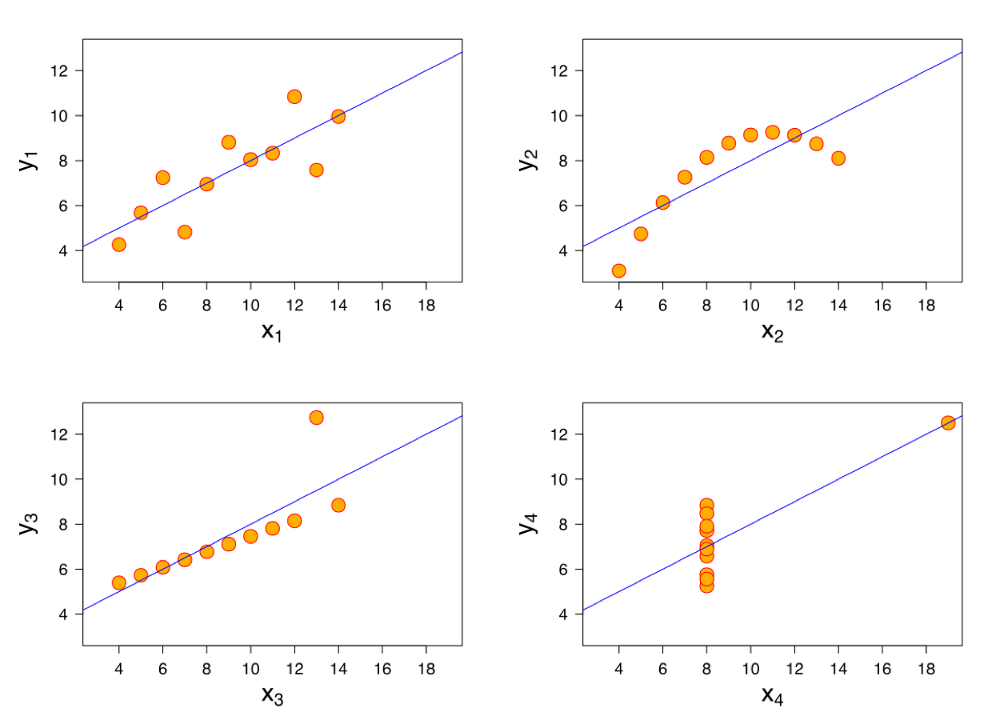

---
execute:
    eval: true

df-print: paged
---

# Plotting your data

In this chapter you learn how to plot your data. We start with a few quick plots in base R, and then spend most of the chapter on **ggplot2**, the plotting package of the tidyverse.

As always, load the tidyverse and read the data first. This time we need both the growth data and the timecourse data:

```{r}
#| message: false
#| warning: false

# load the tidyverse
library(tidyverse)

# read in the data
growth_data <- read_tsv("data/Growth_Data.txt", show_col_types = FALSE)
timecourse <- read_tsv("data/Timecourse.txt", show_col_types = FALSE)
```

## Why plot your data?

Plots are not only for papers and presentations. They are one of the best ways to check your data before you run any statistics. Summary numbers can hide a lot. @fig-anscombe shows a famous example: four small data sets with almost the same mean, variance and regression line, but with very different patterns. Only the first one is described well by a straight line. Without plotting, you would never notice.

{#fig-anscombe width="70%"}

So make it a habit to plot your data first, and look at it.

## Quick plots in base R

Base R has its own plotting functions. They are not as flexible as ggplot2, but for a quick look at your data they are often faster to type. You will also see them a lot in other people's code, and we use some of them in the statistics chapter.

`plot()` draws a scatter plot. Like `lm()` and `t.test()`, it takes a formula: `y ~ x`, read as "y depends on x", and the data frame with `data`:

```{r}
# root length against shoot weight
plot(Rootlength ~ FW_shoot_mg, data = growth_data)
```

Plants with a missing root length or shoot weight are simply left out.

`hist()` draws a histogram. It takes a single column, which we get with `$`:

```{r}
# distribution of the root length
hist(growth_data$Rootlength)
```

`boxplot()` draws a boxplot per group:

```{r}
# root length per nutrient level
boxplot(Rootlength ~ Nutrient, data = growth_data)
```

A boxplot summarizes the values of each group:

- the thick line in the box is the median: half of the values are above it, half below
- the box goes from the first to the third quartile, so it holds the middle 50% of the values
- the whiskers (the thin lines) go to the most extreme values that are no further than 1.5 times the height of the box away from the box
- values further away are drawn as single points. They are often called outliers, but that does not mean that they are wrong

All three functions take arguments for labels, for example `xlab`, `ylab` and `main` (the title):

```{r}
boxplot(Rootlength ~ Nutrient, data = growth_data,
        xlab = "Phosphate level", ylab = "Root length (mm)", main = "Root length")
```

For quick checks, this is all you need. For plots with colors, groups and several panels, base R code quickly gets long and hard to read. This is where ggplot2 is much easier.

## Your first ggplot

Every ggplot is built from the same parts:

1. `ggplot()` starts the plot. You give it the data frame, and in `aes()` (short for **aesthetics**) you say which column goes on which axis.
2. A **geom** says how to draw the data, for example as points (`geom_point()`), boxes (`geom_boxplot()`) or lines (`geom_line()`).
3. The parts are added to each other with `+`. Each part is a **layer** of the plot.

Let's make the same scatter plot as above:

```{r}
ggplot(growth_data, aes(x = FW_shoot_mg, y = Rootlength)) +
  geom_point()
```

Notice the warning that starts with "Removed 23 rows containing missing values". ggplot2 leaves out the plants with a missing root length (15) or a missing shoot weight (8), just like base R. But unlike base R, it tells you about it. This is not an error: the plot is still made. Now that we know what the warning means, we hide it in the rest of this chapter with `#| warning: false` at the top of the chunks.

Always put the `+` at the end of a line, not at the start of the next one. Otherwise R thinks the plot is finished after the first line.

### Exercise

Plot the root length (y-axis) against the condition (x-axis). What is different from the plot above?

::: {.callout-tip collapse="true"}
## Solution

```{r}
#| warning: false
ggplot(growth_data, aes(x = Condition, y = Rootlength)) +
  geom_point()
```

Because `Condition` is text and not a number, ggplot2 makes one column of points per condition. Many points lie on top of each other, so it is hard to see how many plants there are. We fix this later with boxplots and `geom_jitter()`.
:::

## Store and save your plots

You can store a plot in an object, like any other result in R. To see the plot, type the name of the object:

```{r}
#| warning: false
root_shoot_plot <- ggplot(growth_data, aes(x = FW_shoot_mg, y = Rootlength)) +
  geom_point()

root_shoot_plot
```

`ggsave()` saves a plot to a file. The file type comes from the file name, for example `.pdf`, `.png` or `.svg`. With `width`, `height` and `units` you set the size:

```{r}
#| warning: false
ggsave("output_examples/Plot_root_length.pdf", plot = root_shoot_plot,
       width = 12, height = 10, units = "cm")
```

For figures in a paper or a poster, save your plots as **vector** files, such as pdf or svg. A vector file stores lines and points as shapes, so you can zoom in without losing quality, and you can still change details in programs like Inkscape or Illustrator. Raster files, such as png or jpg, store pixels. They are fine for slides and websites.

You can also save the plot that you see in the Plots pane with the **Export** button above the plot.

## Aesthetics: colors, shapes and more

So far, we put columns on the x- and y-axis. In `aes()`, you can also link columns to other properties of the plot, for example:

- `color`: the color of points and lines
- `fill`: the color inside boxes and bars
- `shape`: the shape of points
- `linetype`: solid, dashed or dotted lines

Let's color the points by nutrient level:

```{r}
#| warning: false
ggplot(growth_data, aes(x = FW_shoot_mg, y = Rootlength, color = Nutrient)) +
  geom_point()
```

ggplot2 picks the colors and adds a legend for us.

There is an important difference between setting a property **inside** and **outside** `aes()`:

- Inside `aes()`, you link the property to a column: each nutrient level gets its own color.
- Outside `aes()`, in the geom, you give a fixed value for all points.

For example, to make all points blue and a bit transparent (with `alpha`, from 0 for invisible to 1 for solid):

```{r}
#| warning: false
ggplot(growth_data, aes(x = FW_shoot_mg, y = Rootlength)) +
  geom_point(color = "blue", alpha = 0.4)
```

### Exercise

Make the scatter plot again. Color the points by condition, and give each nutrient level its own shape.

::: {.callout-tip collapse="true"}
## Solution

```{r}
#| warning: false
ggplot(growth_data, aes(x = FW_shoot_mg, y = Rootlength, color = Condition, shape = Nutrient)) +
  geom_point()
```
:::

## Geoms: different types of plots

To change the type of plot, you change the geom. Here are the ones you will use most.

### Boxplots

```{r}
#| warning: false
ggplot(growth_data, aes(x = Condition, y = Rootlength)) +
  geom_boxplot()
```

A boxplot hides how many plants there are. You can show them by adding the points as a second layer. `geom_jitter()` draws the points with a bit of random sideways noise, so they don't lie on top of each other. With `width` you set how far they spread:

```{r}
#| warning: false
ggplot(growth_data, aes(x = Condition, y = Rootlength)) +
  geom_boxplot(outlier.shape = NA) +
  geom_jitter(width = 0.2, alpha = 0.3)
```

`outlier.shape = NA` hides the outlier points of the boxplot. Otherwise these plants would be drawn twice: once by the boxplot and once by `geom_jitter()`.

With `fill`, we get one box per nutrient level within each condition:

```{r}
#| warning: false
ggplot(growth_data, aes(x = Condition, y = Rootlength, fill = Nutrient)) +
  geom_boxplot()
```

### Histograms

A histogram only needs the x-axis. ggplot2 counts how many plants fall into each interval (bin). With `binwidth` you set the width of the bins, here 5 mm:

```{r}
#| warning: false
ggplot(growth_data, aes(x = Rootlength)) +
  geom_histogram(binwidth = 5)
```

To compare the nutrient levels, we fill the bars by nutrient. `position = "identity"` draws the two histograms on top of each other instead of stacking them, and `alpha` makes them transparent, so we can see both:

```{r}
#| warning: false
ggplot(growth_data, aes(x = Rootlength, fill = Nutrient)) +
  geom_histogram(binwidth = 5, position = "identity", alpha = 0.5)
```

### Line plots

Line plots are good for measurements over time, like our timecourse data. We don't want a line through every single plant, but through the mean of each group at each time point. So we first summarize the data with `group_by()` and `summarize()`, as in the chapter "Working with the tidyverse":

```{r}
# mean root length per nutrient, condition and time point
timecourse_summary <- timecourse |>
  group_by(Nutrient, Condition, Timepoint) |>
  summarize(mean_root = mean(Rootlength)) |>
  ungroup()

timecourse_summary
```

Let's plot the plants grown with low phosphate. `color = Condition` gives us one line per condition, and we add the points on top of the lines:

```{r}
timecourse_summary |>
  filter(Nutrient == "low_P") |>
  ggplot(aes(x = Timepoint, y = mean_root, color = Condition)) +
  geom_line() +
  geom_point()
```

Notice that we can give the result of a pipe straight to `ggplot()`. After `ggplot()`, the layers are joined with `+`, not with `|>`.

### Trend lines

`geom_smooth()` adds a trend line to a scatter plot. With `method = "lm"` it draws the straight line of a linear model, which you will learn about in the statistics chapter. The grey band shows how uncertain the line is:

```{r}
#| warning: false
#| message: false
ggplot(growth_data, aes(x = FW_shoot_mg, y = Rootlength)) +
  geom_point(alpha = 0.3) +
  geom_smooth(method = "lm")
```

If you color by a column, you get one line per group:

```{r}
#| warning: false
#| message: false
ggplot(growth_data, aes(x = FW_shoot_mg, y = Rootlength, color = Nutrient)) +
  geom_point(alpha = 0.3) +
  geom_smooth(method = "lm")
```

### Exercise

1.  Make a boxplot of the shoot weight per condition, with the plants shown as points.
2.  Make a line plot of the timecourse for the plants grown with **high** phosphate.

::: {.callout-tip collapse="true"}
## Solution

```{r}
#| warning: false
# 1. shoot weight per condition
ggplot(growth_data, aes(x = Condition, y = FW_shoot_mg)) +
  geom_boxplot(outlier.shape = NA) +
  geom_jitter(width = 0.2, alpha = 0.3)

# 2. timecourse with high phosphate
timecourse_summary |>
  filter(Nutrient == "high_P") |>
  ggplot(aes(x = Timepoint, y = mean_root, color = Condition)) +
  geom_line() +
  geom_point()
```
:::

## Bar graphs with error bars

In biology, you often see bar graphs that show the mean of each group with error bars. For this, we first make a table with the mean and the standard deviation of each group. The **standard deviation** (sd) describes how much the root length varies between the plants of a group: the larger it is, the more the plants differ from each other.

```{r}
# mean and standard deviation of the root length per treatment
root_summary <- growth_data |>
  group_by(Nutrient, Condition) |>
  summarize(mean_root = mean(Rootlength, na.rm = TRUE),
            sd_root = sd(Rootlength, na.rm = TRUE)) |>
  ungroup()

root_summary
```

`geom_col()` draws bars with the height that is given in the data. `geom_errorbar()` draws the error bars, from `ymin` to `ymax`:

```{r}
ggplot(root_summary, aes(x = Condition, y = mean_root, fill = Nutrient)) +
  geom_col(position = position_dodge()) +
  geom_errorbar(aes(ymin = mean_root - sd_root, ymax = mean_root + sd_root),
                position = position_dodge(width = 0.9), width = 0.2)
```

`position_dodge()` puts the bars of the two nutrient levels next to each other instead of on top of each other. The error bars need the same dodge, so that they end up on top of the right bar.

::: callout-important
## What do the error bars show?

Error bars can show different things: the standard deviation, the **standard error** of the mean, or a confidence interval. These can differ a lot in size for the same data, so a reader can only interpret your error bars if you say which one you use. Always write it in the figure legend, for example "mean ± sd". The statistics chapter shows how large the difference between sd and se can be.
:::

A bar graph only shows the mean of each group and hides everything else. A boxplot with the points, as above, shows how the plants are spread and how many there are. Think about which plot tells your reader more.

## Order of the groups

ggplot2 sorts text columns alphabetically. That is why `129E` and `13C` come before `mock`, and `high_P` before `low_P`. Often you want another order, for example with the control first.

Remember factors from the chapter "Data objects"? The order of the levels sets the order in the plot. With `mutate()` and `factor()`, we set the order ourselves:

```{r}
growth_data <- growth_data |>
  mutate(Condition = factor(Condition, levels = c("mock", "129E", "13C")),
         Nutrient = factor(Nutrient, levels = c("low_P", "high_P")))
```

Now the control comes first, and low phosphate before high phosphate:

```{r}
#| warning: false
ggplot(growth_data, aes(x = Condition, y = Rootlength, fill = Nutrient)) +
  geom_boxplot()
```

## Facets: one panel per group

Sometimes a plot gets clearer if you split it into several panels, one per group. This is called **faceting**. `facet_wrap()` makes one panel for each value of a column. The `~` reads as "by":

```{r}
#| warning: false
ggplot(growth_data, aes(x = Condition, y = Rootlength)) +
  geom_boxplot(outlier.shape = NA) +
  geom_jitter(width = 0.2, alpha = 0.3) +
  facet_wrap(~ Nutrient)
```

By default, all panels have the same axes, which makes it easy to compare them. With `scales = "free_y"`, each panel gets its own y-axis. And with `ncol` or `nrow` you set how the panels are arranged.

### Exercise

Plot the timecourse for both nutrient levels, with one panel per nutrient level.

::: {.callout-tip collapse="true"}
## Solution

```{r}
ggplot(timecourse_summary, aes(x = Timepoint, y = mean_root, color = Condition)) +
  geom_line() +
  geom_point() +
  facet_wrap(~ Nutrient)
```
:::

## Labels, colors and themes

The default plots are good for a first look. For a report or a paper, you usually want better labels, your own colors and a cleaner look.

- `labs()` sets the axis titles, the legend title and a plot title.
- `scale_fill_manual()` sets your own colors for `fill` (and `scale_color_manual()` for `color`). You can name the colors, so that each group gets the right one.
- A **theme** sets the overall look. `theme_classic()` has no grey background and no grid lines. Other built-in themes are, for example, `theme_bw()` and `theme_minimal()`.
- `theme()` changes single parts of the plot, for example where the legend goes.

```{r}
#| warning: false
root_plot <- ggplot(growth_data, aes(x = Condition, y = Rootlength, fill = Nutrient)) +
  geom_boxplot() +
  scale_fill_manual(values = c(low_P = "grey80", high_P = "grey30")) +
  labs(x = "Condition", y = "Root length (mm)", fill = "Phosphate") +
  theme_classic() +
  theme(legend.position = "bottom")

root_plot
```

Colors can be given by name, like `"grey80"`, or as a hex code, like `"#2A6FDB"`. Choose colors that people with color blindness can tell apart, and that still work when printed in grey.

## Combine several plots

For a figure with several panels, you can combine plots with `ggarrange()` from the ggpubr package. Install it once with `install.packages("ggpubr")` in the Console. We also use ggpubr in the statistics chapter.

Let's make a second plot for the shoot weight, with the same look:

```{r}
#| warning: false
shoot_plot <- ggplot(growth_data, aes(x = Condition, y = FW_shoot_mg, fill = Nutrient)) +
  geom_boxplot() +
  scale_fill_manual(values = c(low_P = "grey80", high_P = "grey30")) +
  labs(x = "Condition", y = "Shoot fresh weight (mg)", fill = "Phosphate") +
  theme_classic() +
  theme(legend.position = "bottom")
```

`ggarrange()` takes the plots, labels for the panels, and the number of columns and rows. `common.legend = TRUE` shows the legend only once:

```{r}
#| warning: false
library(ggpubr)

combined_plot <- ggarrange(root_plot, shoot_plot,
                           labels = c("A", "B"),
                           ncol = 2, nrow = 1,
                           common.legend = TRUE, legend = "bottom")

combined_plot
```

You save it with `ggsave()`, as any other plot:

```{r}
#| warning: false
ggsave("output_examples/Two_plots.pdf", plot = combined_plot,
       width = 18, height = 10, units = "cm")
```

## Summary

In this chapter you learned how to:

-   make quick plots in base R with `plot()`, `hist()` and `boxplot()`
-   build a ggplot from data, `aes()` and geoms, joined with `+`
-   store plots in objects and save them with `ggsave()`
-   link columns to colors, fills and shapes in `aes()`, or set fixed values outside `aes()`
-   make scatter plots, boxplots, histograms, line plots, trend lines and bar graphs with error bars
-   set the order of groups with factor levels
-   split a plot into panels with `facet_wrap()`
-   change labels, colors and the theme
-   combine several plots with `ggarrange()`

## Further reading

-   [An introduction into ggplot](https://ndombrowski.github.io/Ggplot_tutorial/): a tutorial with more examples and exercises, on a different data set (penguins). It goes deeper into topics that we only touched here, such as position adjustments, scales and axes, themes, and packages that extend ggplot2.
-   The [ggplot2 website](https://ggplot2.tidyverse.org/) lists all geoms and functions, with examples.
