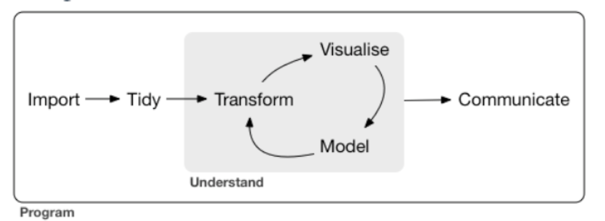

---
execute:
    eval: true

df-print: paged
---

# Working with the tidyverse

So far, we used functions that come with R itself. This is called **base R**. In this chapter you learn a second way to work with tables: the **tidyverse**. The tidyverse is a collection of packages that share one idea. Each function does one job, and you combine these small functions step by step into a longer analysis.

Before you start, create a new Quarto document for this chapter in your project folder, for example `tidyverse.qmd`.

## Why learn a second way?

Let's start with a question about our growth data: **what is the mean root length for each condition, in the plants grown with low phosphate?**

Here is one way to answer it in base R. Don't worry if you don't understand every detail:

```{r}
#| echo: false
#| warning: false
suppressPackageStartupMessages(library(tidyverse))
growth_data <- read_tsv("data/Growth_Data.txt", show_col_types = FALSE)
```

```{r}
# keep the low phosphate plants that have a root length
low_P <- growth_data[growth_data$Nutrient == "low_P" & !is.na(growth_data$Rootlength), ]

# calculate the mean root length for each condition
tapply(low_P$Rootlength, low_P$Condition, mean)
```

This works, but it is hard to read. The first line does three things at once: it compares the nutrient, checks for missing values and selects rows, all inside square brackets. You have to read it from the inside out.

Here is the same question answered with the tidyverse:

```{r}
growth_data |>
  filter(Nutrient == "low_P") |>
  group_by(Condition) |>
  summarize(mean_root = mean(Rootlength, na.rm = TRUE))
```

We get the same numbers. But now the code reads from top to bottom, almost like a sentence: take the growth data, *then* keep the low phosphate plants, *then* make groups by condition, *then* calculate the mean root length for each group. The `|>` at the end of each line means "and then". It is called the **pipe**.

Because each step is one line that does one job, it is easy to change the analysis. Do you want the mean per condition *and* per experiment? Add one column name:

```{r}
growth_data |>
  filter(Nutrient == "low_P") |>
  group_by(Condition, Experiment) |>
  summarize(mean_root = mean(Rootlength, na.rm = TRUE))
```

You can ignore the message about "grouped output" for now. We explain it later in this chapter.

Do you want the high phosphate plants instead? Change one word in the `filter()` line. This is what makes the tidyverse so handy: you build an analysis from small blocks, and you can add, remove or swap blocks without rewriting everything.

So why did we learn base R first? Because you will see it everywhere: in older scripts, in other people's code, in answers on the internet and in the help pages. The things you learned in the previous chapters, like `$`, `[rows, columns]`, vectors and data types, also stay useful in the tidyverse. From now on, this book uses the tidyverse for working with tables.

## The tidyverse packages

The tidyverse contains several packages, each for one kind of task:

- **ggplot2** for plotting
- **dplyr** for changing tables: filtering, sorting, adding columns, summarizing
- **tidyr** for tidying tables, for example changing their shape
- **readr** for reading data
- **tibble** for **tibbles**, a modern version of data frames (you met them in the chapter "First steps in R")
- **stringr** for working with text
- **forcats** for working with factors
- **purrr** for repeating a task many times

@fig-workflow shows where these tasks fit in a typical data analysis. You import your data, tidy it, and then go back and forth between transforming, plotting (visualise) and statistics (model) until you understand your data. In this chapter we focus on **transforming**: selecting, changing and summarizing the data in a table. The plotting chapter covers ggplot2.

{#fig-workflow width="75%"}

You installed the tidyverse in the chapter [First steps in R](first_steps.qmd). If you skipped that, type this into the Console:

```{r}
#| eval: false
install.packages("tidyverse")
```

Then load the tidyverse at the top of your document:

```{r}
#| message: false
#| warning: false
# load the tidyverse
library(tidyverse)
```

The tidyverse also has its own functions to read data, in the package readr. Our growth data is a tab-separated file (tsv, for tab-separated values), so we read it with `read_tsv()`:

```{r}
# read in the growth data
growth_data <- read_tsv("data/Growth_Data.txt")
```

`read_tsv()` tells you which data type it picked for each column: `chr` (character) for `Nutrient`, `Condition` and `Experiment`, and `dbl` (double, a number) for the two measurements. Check this message every time you read data. If a column of numbers is read as `chr`, there is probably some text in it, for example a typo or a comment.

Compared with `read.table()`, you need fewer arguments: `read_tsv()` knows that the columns are separated by tabs and that the first line holds the column names. It also reads empty cells as missing values (`NA`).

`read_tsv()` gives you a **tibble**, like `read_excel()` in the chapter "First steps in R". When you print a tibble, you only see the first 10 rows, and R tells you how many rows the table has:

```{r}
growth_data
```

In this book and in your Quarto document, the tibble is shown as a table with pages. The number of rows is below the table, for example "1-10 of 594 rows", and you can click through the pages. The data type of each column is shown under its name. In the Console, the first line tells you the number of rows and columns instead, for example `# A tibble: 594 × 5`.

This is very handy in this chapter. After each step, you see how many rows are left, without printing hundreds of rows.

## Pipes and shortcuts

The pipe `|>` takes what is on its left and puts it into the function on its right, as the first argument. These two lines do the same:

```{r}
#| eval: false
head(growth_data)
growth_data |> head()
```

With one function, the pipe does not help much. It gets useful when you chain several functions, as in the example above. We will write each step on its own line, with the pipe at the end of the line.

You will also see a second pipe, `%>%`, in a lot of code. It is the older version, from before R had its own pipe. For what we do in this book, both work the same. We use `|>`, which needs R 4.1 or newer.

Two keyboard shortcuts make your life easier:

- **Ctrl+Shift+M** (Cmd+Shift+M on Mac) types a pipe. By default, RStudio types `%>%`. To get `|>`, go to Tools \> Global Options \> Code and tick "Use native pipe operator".
- **Tab** completes what you are typing. Type `filt` and press Tab to see all functions that start with these letters.

## A first look at the data

You already know `head()` and `str()`. A third function, `summary()`, gives you a quick overview of each column:

```{r}
summary(growth_data)
```

For the text columns, `summary()` only tells you how many values there are. For the numeric columns, it shows the smallest and largest value, the mean, the median and the quartiles. It also counts the missing values (`NA's`): 15 plants have no root length, and 8 plants have no shoot weight. We come back to these later.

## Filter rows with `filter()`

`filter()` keeps the rows that meet a condition (@fig-filter).

{#fig-filter width="70%"}

For example, to keep only the plants grown with low phosphate:

```{r}
growth_data |>
  filter(Nutrient == "low_P")
```

`==` means "is equal to". Note that it has two equal signs: a single `=` is used for arguments. Text, like `"low_P"`, always goes in quotes.

The result has 300 rows instead of 594. But `growth_data` itself has not changed: `filter()` only shows the result. If you want to keep it, store it in a new object:

```{r}
# store the low phosphate plants in a new object
low_P_data <- growth_data |>
  filter(Nutrient == "low_P")

# check the number of rows
nrow(low_P_data)
```

Here is the same filter in base R, which you will see in other people's code:

```{r}
#| eval: false
growth_data[growth_data$Nutrient == "low_P", ]
```

You need to write `growth_data` twice, plus the brackets and the comma. In `filter()`, you just write the column name.

These are the **comparison operators** you can use in `filter()`:

| Operator | Meaning |
|---|---|
| `==` | equal to |
| `!=` | not equal to |
| `<` | less than |
| `<=` | less than or equal to |
| `>` | greater than |
| `>=` | greater than or equal to |
| `!` | not |
| `&` | and |
| `|` | or |

For example, by using `!= "mock"` we can remove all mock plants, so we keep only the plants with bacteria:

```{r}
growth_data |>
  filter(Condition != "mock")
```

And `>` works on numbers. We could for example only list plants that have roots longer than 100 mm:

```{r}
growth_data |>
  filter(Rootlength > 100)
```

### Filter on more than one column

You can give `filter()` several conditions, separated by a comma. A row is kept only if it meets **all** conditions:

```{r}
# plants grown with low phosphate and with strain 129E
growth_data |>
  filter(Nutrient == "low_P", Condition == "129E")
```

### Filter for several values with `%in%`

What if you want the plants of both strains, 129E and 13C? One way is the "or" operator `|`:

```{r}
growth_data |>
  filter(Condition == "129E" | Condition == "13C") |>
  nrow()
```

Here we added `nrow()` at the end of the pipe, to count the rows instead of printing the whole table.

With many values, this means a lot of typing. `%in%` is shorter. It checks whether a value is in a vector:

```{r}
# the conditions we want to keep
strains <- c("129E", "13C")

growth_data |>
  filter(Condition %in% strains) |>
  nrow()
```

A vector like `strains` is easy to read, easy to extend and you can use it again later.

### Exercise

1.  How many plants were grown in experiment `ex64`?
2.  How many plants grown with high phosphate have a shoot weight of 20 mg or more?

::: {.callout-tip collapse="true"}
## Solution

```{r}
# 1. plants in experiment ex64
growth_data |>
  filter(Experiment == "ex64") |>
  nrow()

# 2. high phosphate plants with a shoot weight of at least 20 mg
growth_data |>
  filter(Nutrient == "high_P", FW_shoot_mg >= 20) |>
  nrow()
```

There are 205 plants from experiment `ex64`, and 137 high phosphate plants with a shoot weight of at least 20 mg.
:::

## Select columns with `select()`

`filter()` chooses rows, `select()` chooses columns. You list the columns you want to keep:

```{r}
growth_data |>
  select(Condition, Rootlength)
```

With `!` you remove columns instead. To remove more than one, put them in `c()`:

```{r}
# keep all columns except Experiment and FW_shoot_mg
growth_data |>
  select(!c(Experiment, FW_shoot_mg))
```

**Selection helpers** select columns by a pattern in their name:

- `starts_with()`: the name starts with some text
- `ends_with()`: the name ends with some text
- `contains()`: the name contains some text

```{r}
# all columns whose name starts with FW
growth_data |>
  select(starts_with("FW"))
```

In our small table, this does not save much typing. But many tables in biology have hundreds of columns, for example one per sample or per gene. Then helpers like these are very useful.

### Exercise

Select the columns `Nutrient` and `Condition` and all columns whose name contains `length`.

::: {.callout-tip collapse="true"}
## Solution

```{r}
growth_data |>
  select(Nutrient, Condition, contains("length"))
```
:::

## Remove duplicates with `distinct()`

`distinct()` keeps each value, or each combination of values, only once. It is the tidyverse version of `unique()`, which you used in "First steps in R":

```{r}
# each combination of nutrient and condition only once
growth_data |>
  distinct(Nutrient, Condition)
```

## Count rows with `count()`

`count()` counts the rows for each value, or each combination of values. How many plants do we have per treatment?

```{r}
growth_data |>
  count(Nutrient, Condition)
```

The column `n` holds the number of plants. Not all groups have the same size: we have between 87 and 107 plants per group.

### Exercise

How many plants were measured in each experiment?

::: {.callout-tip collapse="true"}
## Solution

```{r}
growth_data |>
  count(Experiment)
```

The three experiments have 194, 205 and 195 plants.
:::

## Sort rows with `arrange()`

`arrange()` sorts the rows by the values in a column (@fig-arrange). By default, it starts with the smallest value:

{#fig-arrange width="70%"}

```{r}
growth_data |>
  arrange(Rootlength)
```

With `desc()` (short for descending) you start with the largest value. This is a quick way to find extreme values, for example to spot typos in your data:

```{r}
growth_data |>
  arrange(desc(Rootlength))
```

The three plants with the longest roots were all grown with high phosphate and with one of the two strains.

### Exercise

Which plant has the highest shoot weight? In which nutrient, condition and experiment was it grown?

::: {.callout-tip collapse="true"}
## Solution

```{r}
growth_data |>
  arrange(desc(FW_shoot_mg))
```

The heaviest shoot weighs 47.6 mg. It is a mock plant, grown with high phosphate in experiment `ex64`.
:::

## Add or change columns with `mutate()`

`mutate()` adds new columns, or changes existing ones (@fig-mutate).

{#fig-mutate width="70%"}

For example, we can convert the shoot weight from mg to g. Before the `=`, you write the name of the new column. After the `=`, you say how to calculate it. The new column is added at the end of the table:

```{r}
# convert mg to g (1 g = 1000 mg)
growth_data |>
  mutate(FW_shoot_g = FW_shoot_mg / 1000)
```

In base R, you would write `growth_data$FW_shoot_g <- growth_data$FW_shoot_mg / 1000`, as in the chapter "Data objects".

You can also calculate with several columns, and make several new columns in one `mutate()`, separated by commas:

```{r}
growth_data |>
  mutate(FW_shoot_g = FW_shoot_mg / 1000,
         root_shoot_ratio = Rootlength / FW_shoot_mg)
```

Any calculation with a missing value gives a missing value. Rows 32 and 33 have no shoot weight, so their ratio is `NA` too. `slice()` shows rows by their number:

```{r}
growth_data |>
  mutate(root_shoot_ratio = Rootlength / FW_shoot_mg) |>
  slice(32:33)
```

### Exercise

Add a column with the root length in cm.

::: {.callout-tip collapse="true"}
## Solution

```{r}
# 1 cm = 10 mm
growth_data |>
  mutate(Rootlength_cm = Rootlength / 10)
```
:::

## Combine several steps

The real strength of the tidyverse shows when you chain several steps. Let's find the three plants with the longest roots among the low phosphate plants with strain 129E, and only show the columns we need:

```{r}
growth_data |>
  filter(Nutrient == "low_P", Condition == "129E") |>
  arrange(desc(Rootlength)) |>
  select(Experiment, Rootlength) |>
  head(3)
```

Read it line by line: take the growth data, keep the low phosphate plants with 129E, sort them from the longest to the shortest root, keep two columns, show the first three rows.

When you build a pipe like this, add one step at a time and run the code after each step. Then you see what each step does, and you find mistakes quickly.

### Exercise

What is the heaviest shoot weight, **in g**, of a mock plant grown with high phosphate? From which experiment does that plant come?

::: {.callout-tip collapse="true"}
## Solution

```{r}
growth_data |>
  filter(Nutrient == "high_P", Condition == "mock") |>
  mutate(FW_shoot_g = FW_shoot_mg / 1000) |>
  arrange(desc(FW_shoot_g)) |>
  select(Experiment, FW_shoot_g) |>
  head(1)
```

The heaviest shoot weighs 0.0476 g and comes from experiment `ex64`.
:::

::: callout-warning
## Filtering and factor levels

Remember factors from the chapter "Data objects"? A factor keeps all its levels, even when you filter away all rows of a level. Let's turn `Condition` into a factor with `mutate()`, and then keep only the strain 129E:

```{r}
only_129E <- growth_data |>
  mutate(Condition = factor(Condition)) |>
  filter(Condition == "129E")

levels(only_129E$Condition)
```

`13C` and `mock` are still levels, although no row has them anymore. In plots and statistics, these empty levels can show up as empty groups. `droplevels()` removes them:

```{r}
only_129E <- only_129E |>
  droplevels()

levels(only_129E$Condition)
```
:::

## Missing values

`summary()` showed us that our data has missing values: 15 in `Rootlength` and 8 in `FW_shoot_mg`. Many calculations give `NA` if one of the values is missing. What you do about it depends on your question. Here we look at two ways to remove rows with missing values.

`drop_na()` removes every row that has a missing value in **any** column:

```{r}
growth_data |>
  drop_na() |>
  nrow()
```

`filter()` together with `is.na()` removes only the rows with a missing value in **one** column. `is.na()` is `TRUE` for a missing value, and `!` turns it around, so we keep the rows that are not missing:

```{r}
growth_data |>
  filter(!is.na(Rootlength)) |>
  nrow()
```

`drop_na()` removes 23 rows, `filter()` only 15. None of our plants misses both measurements. So `drop_na()` also throws away 8 plants that **do** have a root length, only because their shoot weight is missing. If you analyse the root length, this is good data lost. Only remove the missing values you need to remove.

You can also give `drop_na()` the name of a column. Then it only looks at that column, and `drop_na(Rootlength)` does the same as our `filter()`.

## Summarize data with `group_by()` and `summarize()`

`summarize()` turns many rows into one row, for example by calculating a mean (@fig-summarize).

{#fig-summarize width="70%"}

```{r}
growth_data |>
  summarize(mean_root = mean(Rootlength, na.rm = TRUE))
```

`na.rm = TRUE` tells `mean()` to ignore the missing values. Without it, the mean would be `NA`.

One mean for all plants is not very useful, because our plants got different treatments. This is where `group_by()` comes in. It splits the table into groups, and `summarize()` then calculates one row for each group (@fig-group-by).

{#fig-group-by width="70%"}

Let's calculate the mean and the standard deviation of the root length for each treatment, and count the plants. You can calculate several things in one `summarize()`, separated by commas:

```{r}
growth_data |>
  group_by(Nutrient, Condition) |>
  summarize(mean_root = mean(Rootlength, na.rm = TRUE),
            sd_root = sd(Rootlength, na.rm = TRUE),
            n_plants = sum(!is.na(Rootlength))) |>
  ungroup()
```

To count the plants, we use `sum(!is.na(Rootlength))`. `!is.na()` is `TRUE` for each plant that has a root length, and `sum()` counts the `TRUE` values. This way, we only count the plants that were used for the mean. Compare the numbers with the output of `count()` above: in some groups, a few plants have no root length.

Functions that are useful inside `summarize()`:

| Function | Calculates |
|---|---|
| `mean()`, `median()` | the center of the data |
| `sd()`, `IQR()` | the spread of the data |
| `min()`, `max()` | the smallest and largest value |
| `n()` | the number of rows in the group |

::: callout-note
## Why `ungroup()`?

`group_by()` does not change how the table looks, but it remembers the groups. After a `summarize()` with two grouping columns, the result is still grouped by the first one. R tells you this with a message like "`summarise()` has grouped output by 'Nutrient'". All functions that come after it in the pipe then work per group, which can give surprising results. `ungroup()` removes the groups. Make it a habit to end with `ungroup()`, especially when you store the result in an object.
:::

### Exercise

Calculate the mean and the median shoot weight for each combination of nutrient and condition.

::: {.callout-tip collapse="true"}
## Solution

```{r}
growth_data |>
  group_by(Nutrient, Condition) |>
  summarize(mean_shoot = mean(FW_shoot_mg, na.rm = TRUE),
            median_shoot = median(FW_shoot_mg, na.rm = TRUE)) |>
  ungroup()
```
:::

::: {.callout-tip collapse="true"}
## Optional: the same calculation for several columns with `across()`

If you want the mean of both the root length and the shoot weight, you can write two lines in `summarize()`. With many columns, `across()` saves typing. It applies the same function to several columns:

```{r}
growth_data |>
  group_by(Nutrient, Condition) |>
  summarize(across(c(Rootlength, FW_shoot_mg), ~ mean(.x, na.rm = TRUE))) |>
  ungroup()
```

The `~` starts a small function, and `.x` stands for each column in turn. So `~ mean(.x, na.rm = TRUE)` means "calculate the mean of this column, without the missing values". The new columns keep the names of the old ones.
:::

## Combine tables with `left_join()`

In "First steps in R", you combined two tables with `merge()`. The tidyverse version is `left_join()`. Let's make a small table that says, for each condition, whether the plants got bacteria:

```{r}
inoculation <- data.frame(Condition = c("mock", "129E", "13C"),
                          Bacteria = c("no", "yes", "yes"))

inoculation
```

Now we add this information to our growth data. The argument `by` says which column to use for matching the rows:

```{r}
growth_with_info <- growth_data |>
  left_join(inoculation, by = "Condition")

head(growth_with_info)
```

As with `merge()`, always check the number of rows after a join. We still want 594 rows, one per plant:

```{r}
nrow(growth_data)
nrow(growth_with_info)
```

Two differences to `merge()` with its default settings:

- `left_join()` keeps **all** rows of the first table (the one on the left), also when they have no match in the second table. The new columns are then `NA`. `merge()` drops these rows, unless you add `all.x = TRUE`.
- `left_join()` keeps the order of the rows of the first table. `merge()` sorts the rows by the `by` columns.

::: callout-warning
## Matching on too few columns

The mistake from "First steps in R" can happen here too. Let's make a mapping file with `distinct()` and join on `Condition` only, although each condition appears twice in the mapping file (once per nutrient):

```{r}
mapping_file <- growth_data |>
  distinct(Nutrient, Condition) |>
  mutate(Source = "Fig S5A,B")

wrong_join <- growth_data |>
  left_join(mapping_file, by = "Condition")

nrow(wrong_join)
```

Again, each plant matches two rows and is copied. Unlike `merge()`, `left_join()` warns you about this: it reports a "many-to-many relationship". Read warnings like this carefully. The fix is the same as before: match on both columns with `by = c("Nutrient", "Condition")`.
:::

## Other useful functions

Some more tidyverse functions that you will need sooner or later. The links go to their help pages, with examples:

- [`pivot_longer()` and `pivot_wider()`](https://tidyr.tidyverse.org/articles/pivot.html) change the shape of a table, from wide (one column per sample) to long (one row per measurement) and back
- [`separate_wider_delim()`](https://tidyr.tidyverse.org/reference/separate_wider_delim.html) splits one column into several, for example `low_P_129E` into `low_P` and `129E`
- [`unite()`](https://tidyr.tidyverse.org/reference/unite.html) does the opposite and pastes several columns into one

## Summary

In this chapter you learned how to:

-   combine steps with the pipe `|>`
-   get an overview of a table with `summary()`
-   keep rows with `filter()`, using comparison operators and `%in%`
-   keep or remove columns with `select()`
-   remove duplicates with `distinct()` and count rows with `count()`
-   sort rows with `arrange()` and `desc()`
-   add or change columns with `mutate()`
-   remove missing values with `drop_na()` or `filter(!is.na())`
-   summarize groups with `group_by()`, `summarize()` and `ungroup()`
-   combine tables with `left_join()`

## Further reading

-   [An introduction into the tidyverse](https://ndombrowski.github.io/Tidyverse_tutorial/): a tutorial with more examples and exercises for the functions in this chapter. It uses a different data set, measurements of penguins, which is good practice for using the same functions on new data.
-   [R for Data Science](https://r4ds.hadley.nz/): a free online book by the authors of the tidyverse.
